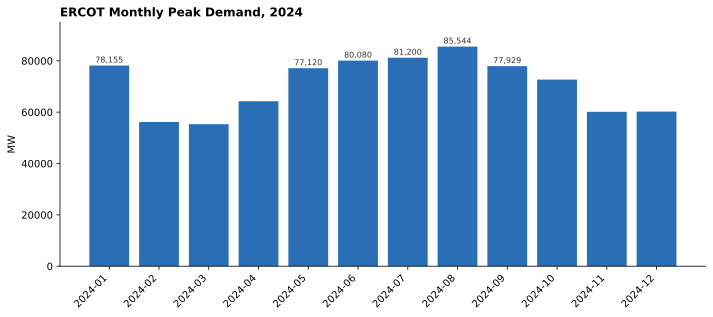
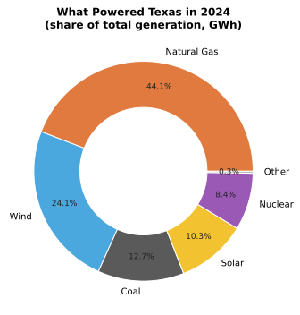
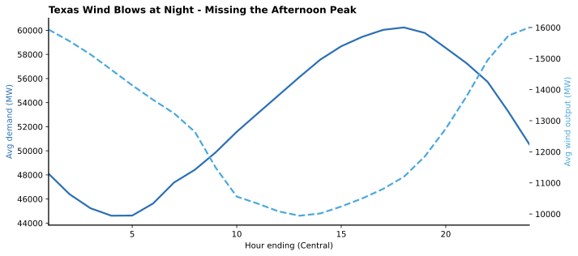

# Texas Grid 2024: ERCOT Demand & Generation Analysis

**SQL | SQLite | Python**

SQL analytics project by **Emy Kirugo**, analyzing 8,783 hours of real Texas electricity grid data from 2024: hourly demand, day-ahead forecast accuracy, and generation by fuel type for the ERCOT grid.

**Dataset:** U.S. Energy Information Administration, Form EIA-930 public bulk files ([EIA Grid Monitor](https://www.eia.gov/electricity/gridmonitor/)), balancing authority `ERCO` (ERCOT). Two half-year files were cleaned and harmonized into one analysis-ready table (see Data notes).

---

## Insight 1: Texas set an all-time demand record in August 2024



Texas hit **85,544 MW** on August 20, 2024 at 6 PM Central - an all-time ERCOT record. Every one of the year's 10 highest-demand hours fell inside a four-day August heat wave (Aug 19-22). Summer still rules the Texas grid, but winter is closer than people think: the January Arctic blast drove demand to 78,155 MW, within 9% of the summer record.

Months are grouped on Central local time so December 31 evening stays in December, and peak hours are reported in Central time - when Texans actually felt them.

## Insight 2: What powered Texas in 2024



Natural gas supplied **44.1%** of Texas electricity in 2024, followed by wind (**24.1%**), coal (**12.7%**), solar (**10.3%**), and nuclear (**8.4%**). Wind and solar together delivered **34.4%** of the state's power - more than one in three megawatt-hours.

A donut chart was chosen over a table because share-of-whole is the entire point of this question. Fuels are ordered by share so the eye lands on gas first, and the sub-1% sources are grouped as "Other" to keep the story readable.

## Insight 3: Gas and solar carried the peaks - wind went missing

During the 10 highest-demand hours of the year, natural gas averaged about **52%** of generation and solar about **21%**, while wind - the state's #2 source overall - averaged just **7%**. The grid leans on dispatchable gas exactly when it matters most, and solar earns its keep on summer afternoons.

This uses a top-N-per-group pattern: all 8,783 hours are ordered by demand, the top 10 are taken, and each hour's generation is broken into fuel shares. No sampling, no estimates.

## Insight 4: Texas wind blows at night



Wind averaged a **33-34% share of generation overnight** but only **about 19% at midday** - almost perfectly anti-correlated with the afternoon demand peak. The dashed wind line falls exactly as the solid demand line rises. This mismatch is the central planning challenge for a wind-heavy grid: the resource is strongest when the state needs it least.

A dual-axis line chart was used because demand and wind share the same hourly x-axis but live on very different scales. Forcing a single axis would flatten the wind story into noise.

## Insight 5: The forecast is good, and Texas stands alone

ERCOT's day-ahead demand forecast averaged **1.4-3.5% MAPE** (mean absolute percentage error) by month - best in calm August (1.4%), worst in volatile January (3.5%). Accuracy turns out to be a weather story, not a modeling story.

And net power imports/exports averaged **under 0.2% of demand** in every single month. Texas really is an electrical island, and here it is in one number.

---

## Data notes

- **Source:** the two public U.S. EIA Form EIA-930 bulk files for 2024. `scripts/build_db.py` downloads them on first run (cached in `data/raw/`, git-ignored), filters to balancing authority `ERCO`, and builds everything from there. No dataset is checked in; the full pipeline is reproducible from the public source.
- **Grain:** 1 row = 1 hour; 8,783 rows covering all of 2024, Central Time.
- **Schema change mid-year:** EIA split its fuel columns in the H2 2024 file (e.g. solar with/without battery storage, hydro excluding pumped storage). The script sums the sub-columns back into one stable schema instead of silently dropping them. One judgment call worth knowing: H2's "Unknown Energy Storage" is grouped into `other_mw`, matching the original build; only the column literally named "Battery Storage" feeds `battery_mw`.
- **The DST hour:** hour `25` on Nov 3 is the repeated 2 a.m. hour when clocks fell back. It is kept as reported, not smoothed away.
- **Adjusted vs reported:** EIA publishes imputed and adjusted variants of every series. This project uses the reported values and documents the choice, so every number traces back to a published cell.

## Project structure

```
├── README.md
├── sql/
│   ├── schema.sql       # CREATE TABLE ercot_hourly
│   └── analysis.sql     # 12 analytical queries (Q1-Q12), portable SQL
├── screenshots/         # chart outputs
├── scripts/
│   ├── build_db.py      # ETL: downloads EIA files -> clean CSV -> SQLite
│   └── charts.py        # regenerates screenshots/ from the database
└── data/raw/            # cached EIA downloads (git-ignored, fetched on first run)
```

`data/ercot_hourly_2024.csv` and `texas_grid.db` are build artifacts: `scripts/build_db.py` regenerates both, so they are git-ignored.

## The 12 queries (`sql/analysis.sql`)

| # | Question | Techniques |
|---|----------|------------|
| Q1 | When did demand peak each month, and how high? | correlated subquery, date functions |
| Q2 | What does a typical Texas day look like? | grouped aggregation |
| Q3 | What powered Texas in 2024? (share by fuel) | UNION ALL unpivot, window function |
| Q4 | How did the renewable share move through the year? | conditional aggregation |
| Q5 | Fuel mix during the 10 highest-demand hours | ORDER BY + LIMIT, share math |
| Q6 | When does Texas wind actually blow? | hourly profiling, NULLIF guards |
| Q7 | Which months deliver the most solar? | monthly aggregation |
| Q8 | How accurate is the day-ahead forecast? (MAPE) | error metrics in SQL |
| Q9 | Net importer or exporter? | signed interchange analysis |
| Q10 | Weekday vs weekend demand | CASE bucketing |
| Q11 | Hours where wind + solar topped 40% | filtered counting, window share |
| Q12 | Summer vs winter peaks and mixes | seasonal CASE bucketing |

Queries are written in portable SQL and run on SQLite here and on PostgreSQL unchanged.

## Run it

```bash
# 1. Build the database from the clean CSV
python3 scripts/build_db.py

# 2. Run all twelve queries
sqlite3 texas_grid.db < sql/analysis.sql

# 3. Regenerate the charts
python3 scripts/charts.py
```

Python is only needed for the ETL and charts (`pandas`, `matplotlib`). The SQL needs nothing but SQLite.
